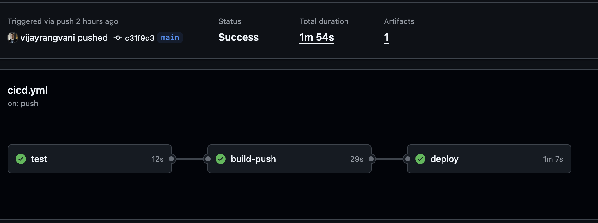
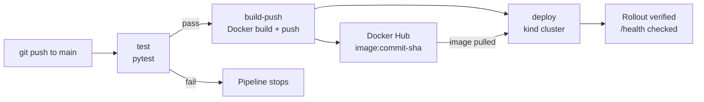
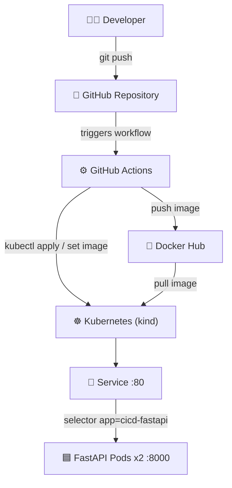

# 🚀 CI/CD Pipeline — FastAPI to Kubernetes with GitHub Actions

> An automated CI/CD pipeline that tests, builds, publishes and deploys a FastAPI application to Kubernetes on every push to `main` — no manual Docker or kubectl steps.


---

## 📌 Table of Contents

<details open>
<summary><b>Click to expand / collapse navigation</b></summary>

- [🔎 Overview](#-overview)
- [📸 Pipeline Run](#-pipeline-run)
- [🧠 What is CI/CD?](#-what-is-cicd)
- [🎯 What This Project Does](#-what-this-project-does)
- [🏗️ Architecture](#️-architecture)
- [🛠️ Technology Stack](#️-technology-stack)
- [📁 Project Structure](#-project-structure)
- [✨ Key Features](#-key-features)
- [🧩 Design Decisions](#-design-decisions)
- [⚡ Quick Start](#-quick-start)
- [⚙️ Setup & Installation](#️-setup--installation)
- [🚀 Pipeline Walkthrough](#-pipeline-walkthrough)
- [🎥 YouTube Demonstration](#-youtube-demonstration)
- [🧩 Troubleshooting](#-troubleshooting)
- [📌 Assignment Coverage](#-assignment-coverage)
- [👨‍💻 Author](#-author)

</details>

---

## 🔎 Overview

This project automates the full path from code change to running deployment. A `git push` to `main` triggers a GitHub Actions workflow with three dependent jobs:

1. **Test** — runs `pytest`; a failure stops the pipeline
2. **Build & Push** — builds a Docker image and pushes it to Docker Hub, tagged with the commit SHA
3. **Deploy** — creates a Kubernetes cluster (kind), deploys the new image, waits for a healthy rollout and verifies the `/health` endpoint

Docker Hub image: [vijayrangvani/cicd-fastapi](https://hub.docker.com/repository/docker/vijayrangvani/cicd-fastapi/)

---

## 📸 Pipeline Run

> A successful run: `test → build-push → deploy`, all green.



---

## 🧠 What is CI/CD?

| Term | Question it answers | Implemented by |
|------|---------------------|----------------|
| **Continuous Integration (CI)** | Is this code change safe? | `test` job + `build-push` job |
| **Continuous Deployment (CD)** | Get the safe change running | `deploy` job |

Without CI/CD, every release means manually running tests, building the image, pushing it and running `kubectl` — slow and error-prone. With CI/CD, every push follows the same verified path.

---

## 🎯 What This Project Does



---

## 🏗️ Architecture



### Component Breakdown

| Component | Role |
|-----------|------|
| **FastAPI app** | Exposes `/health`, returning status and version |
| **pytest** | Verifies `/health` before anything is built |
| **Dockerfile** | Packages the app into an image based on `python:3.14-slim` |
| **GitHub Actions** | Runs the three jobs in order on every push |
| **Docker Hub** | Registry that hands images from CI to Kubernetes |
| **Deployment** | Runs 2 replicas with a readiness probe on `/health` |
| **Service** | Gives the pods one stable address (port 80 → 8000) |

---

## 🛠️ Technology Stack

| Layer | Technology | Function |
|-------|------------|----------|
| **Application** | Python 3.14, FastAPI | API with health endpoint |
| **Testing** | pytest | Automated tests |
| **Container** | Docker | Image build |
| **Registry** | Docker Hub | Image storage |
| **CI/CD** | GitHub Actions | Pipeline automation |
| **Orchestration** | Kubernetes — kind (CI), Docker Desktop (local) | Running the app |

---

## 📁 Project Structure

```text
cicd-fastapi-k8s/
│
├── app/
│   ├── __init__.py
│   └── main.py                   # FastAPI app with /health
│
├── tests/
│   ├── __init__.py
│   └── test_main.py              # pytest tests
│
├── k8s/
│   ├── deployment.yaml           # 2 replicas + readiness probe
│   └── service.yaml              # ClusterIP Service, 80 → 8000
│
├── .github/workflows/
│   └── cicd.yml                  # test → build-push → deploy
│
├── assets/
│   └── pipeline.png              # Successful pipeline run screenshot
│
├── Dockerfile
├── .dockerignore
├── requirements.txt
└── README.md
```

---

## ✨ Key Features

- ✅ **Automated testing gate:** build and deploy run only after tests pass (`needs:`)
- 🏷️ **Traceable images:** every image is tagged with the commit SHA
- ☸️ **Automatic Kubernetes deployment:** new image rolled out on every push
- 🩺 **Health-checked rollouts:** readiness probe + `rollout status` with timeout
- 🔐 **Secrets management:** Docker Hub token stored in GitHub Secrets, never in code
- 🔁 **Reproducible:** each job runs on a fresh machine, so nothing depends on a local setup

---

## 🧩 Design Decisions

| Decision | Why |
|----------|-----|
| Deploy the **commit SHA tag**, not `latest` | Kubernetes only rolls out when the image reference changes; SHA makes every deploy traceable and rollback easy |
| **Readiness probe** on `/health` | Pods receive traffic only once the app responds |
| **`rollout status --timeout`** | The job fails if new pods never become healthy instead of passing silently |
| **Docker Hub access token**, not password | Limited permissions and revocable |
| **kind cluster in CI** | Free, fast and fully automated; in production the deploy job would target a persistent cluster such as AWS EKS |
| Same **Python 3.14** locally, in CI and in the image | Avoids "works on my machine" differences |

---

## ⚡ Quick Start

> Run the app locally in a few commands.

```bash
python3 -m venv .venv && source .venv/bin/activate
pip install -r requirements.txt
pytest -v
uvicorn app.main:app --reload
# Open http://127.0.0.1:8000/health
```

---

## ⚙️ Setup & Installation

### Prerequisites

| Tool | Purpose | Install |
|------|---------|---------|
| Python 3.14 | Run the app and tests | [python.org](https://www.python.org/downloads/) |
| Docker Desktop | Build images, local Kubernetes | [Download](https://www.docker.com/products/docker-desktop/) |
| kubectl | Kubernetes CLI | Bundled with Docker Desktop |
| Docker Hub account | Image registry | [hub.docker.com](https://hub.docker.com) |

### 1. Run with Docker

```bash
docker build -t cicd-fastapi .
docker run -d -p 8000:8000 --name cicd-test cicd-fastapi
curl http://127.0.0.1:8000/health
docker rm -f cicd-test
```

### 2. Run on Kubernetes (Docker Desktop)

```bash
kubectl apply -f k8s/
kubectl rollout status deployment/cicd-fastapi
kubectl port-forward service/cicd-fastapi 8080:80
# Open http://127.0.0.1:8080/health
```

### 3. Configure the Pipeline (for your own fork)

Create a Docker Hub access token (Read & Write), then add two repository secrets under **Settings → Secrets and variables → Actions**:

| Secret | Value |
|--------|-------|
| `DOCKERHUB_USERNAME` | Docker Hub username |
| `DOCKERHUB_TOKEN` | Docker Hub access token |

Push to `main` and watch the **Actions** tab.

---

## 🚀 Pipeline Walkthrough

| Job | Depends on | Steps |
|-----|-----------|-------|
| **test** | — | Checkout → set up Python 3.14 → install dependencies → `pytest -v` |
| **build-push** | `test` | Checkout → Docker Hub login → build and push `:<sha>` and `:latest` |
| **deploy** | `build-push` | Checkout → create kind cluster → `kubectl apply` → `kubectl set image` to `:<sha>` → `rollout status` → curl `/health` |

### Demonstrating Automatic Deployment

1. Change `"version"` in `app/main.py` (e.g. `v2` → `v3`)
2. Commit and push to `main`
3. The **Verify deployment** step logs the new response:

```
Health check response:
{"status":"ok","version":"v3"}
```

> The kind cluster exists only for the duration of the run. Proof of deployment is in the job logs: rollout status, pod list and the `/health` response.

---

## 🎥 YouTube Demonstration

| # | Section |
|---|---------|
| 1 | What the pipeline does — push to deployment |
| 2 | Repo walkthrough — app, tests, Dockerfile, k8s, workflow |
| 3 | Live demo — change version, push, watch all 3 jobs |
| 4 | Show new SHA tag on Docker Hub and `/health` in deploy log |
| 5 | Safety gate — break a test, show build and deploy skipped |
| 6 | Design decisions — SHA tags, probes, rollout status |

---

## 🧩 Troubleshooting

<details>
<summary><b>❌ pytest: collected 0 items</b></summary>

The test file is empty on disk — usually unsaved in the editor. Save the file and rerun. Enabling **File → Auto Save** in VS Code prevents this.
</details>

<details>
<summary><b>❌ Cannot connect to the Docker daemon / docker.sock not found</b></summary>

Docker Desktop is not running:
```bash
open -a Docker
docker info
```
</details>

<details>
<summary><b>❌ ImagePullBackOff</b></summary>

Kubernetes cannot pull the image. Check the image name, tag and that the repository exists on Docker Hub:
```bash
kubectl describe pod <pod-name>
```
</details>

<details>
<summary><b>❌ Service has no endpoints</b></summary>

The Service selector does not match the pod labels. Both must use `app: cicd-fastapi`:
```bash
kubectl get endpoints cicd-fastapi
kubectl get pods --show-labels
```
</details>

<details>
<summary><b>❌ build-push fails at Docker Hub login</b></summary>

Secret names must be exactly `DOCKERHUB_USERNAME` and `DOCKERHUB_TOKEN`, and the username must be the Docker Hub username, not the email.
</details>

---

## 📌 Assignment Coverage

| Requirement | Implementation | Status |
|-------------|---------------|:------:|
| **GitHub trigger** | Workflow runs on push to `main` | ✅ |
| **Automated Testing** | `test` job running pytest | ✅ |
| **Docker Build** | `build-push` job with `docker/build-push-action` | ✅ |
| **Image Push** | Pushed to Docker Hub, tagged with commit SHA | ✅ |
| **Kubernetes Deployment** | `deploy` job: kind cluster, rollout, health check | ✅ |
| **Blue-Green Deployment (Bonus)** | Planned | ⬜ |
| **YouTube Submission** | Pipeline demonstration | ⬜ |

---

## 👨‍💻 Author

**Vijay Rangvani**
*Backend & AI Engineering Learner | Healthcare IT*

| | |
|--|--|
| 🐙 GitHub | [github.com/vijayrangvani](https://github.com/vijayrangvani) |
| 💼 LinkedIn | [linkedin.com/in/vijayrangvani](https://www.linkedin.com/in/vijayrangvani/) |

**Focus Areas:** Python · FastAPI · Docker · Kubernetes · CI/CD · Cloud Systems
